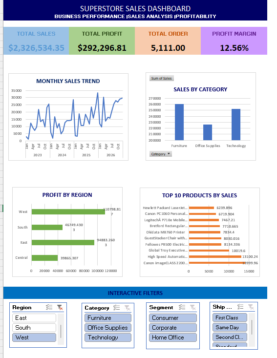

# Sample Superstore Sales Analysis

## Project Overview
This project presents an end-to-end sales and profitability analysis using the Sample Superstore dataset. The analysis was performed in Microsoft Excel to explore sales performance, profitability, customer segments, regional performance and product trends.

The project includes data preparation, PivotTable analysis, PivotCharts and an interactive Excel dashboard.
## Dashboard Preview

## Project Objectives
- Analyse overall sales and profit performance.
- Identify the best-performing product categories.
- Compare profitability across different regions.
- Examine monthly sales trends.
- Understand customer segment performance.
- Analyse the relationship between discounts and profitability.
- Evaluate shipping performance.
- Identify the top 10 products by sales.

## Tools and Techniques
**Microsoft Excel**
- Data preparation and inspection
- Excel formulas
- PivotTables
- PivotCharts
- Interactive slicers
- KPI calculations
- Dashboard design and visualisation

## Key Performance Indicators (KPIs)

The full-data dashboard displays the following metrics:

| KPI | Result |
|---|---:|
| Total Sales | $2,326,534.35 |
| Total Profit | $292,296.81 |
| Total Orders | 5,111 |
| Profit Margin | 12.56% |

## Analysis Performed

The project covers the following analytical areas:

1. Sales by Category
2. Profit by Category
3. Sales and Profit by Region
4. Customer Segment Analysis
5. Monthly Sales Trend
6. Discount and Profitability Analysis
7. Shipping Performance Analysis
8. Top 10 Products by Sales

## Dashboard Features

The interactive dashboard contains:

- Four KPI cards showing Total Sales, Total Profit, Total Orders and Profit Margin.
- A line chart displaying monthly sales trends.
- A chart comparing sales across product categories.
- A bar chart comparing profit across regions.
- A horizontal bar chart displaying the top 10 products by sales.
- Four interactive slicers for Region, Category, Segment and Ship Mode.

## Key Findings

Based on the full-data analysis:

- Technology recorded the highest sales among the three product categories.
- The West region generated the highest regional profit, approximately $110,798.82.
- The Central region recorded the lowest regional profit, approximately $39,865.31.
- The overall profit margin was approximately 12.56%.

## Project Files

- `Sample-Superstore-Sales-Analysis.xlsx1` – Completed Excel analysis and interactive dashboard.
- `dashboard-preview.png` – Screenshot showing the dashboard.

## How to Use This Project

1. Download the Excel workbook from this repository.
2. Open it using Microsoft Excel desktop.
3. Navigate to the DASHBOARD worksheet.
4. Use the Region, Category, Segment and Ship Mode slicers to explore the data.
5. Visit the PivotTable analysis worksheets to examine the detailed calculations.

Note: The interactive dashboard is designed to be used in Microsoft Excel. GitHub provides access to the workbook file but does not run its Excel slicers or PivotCharts interactively.

## Conclusion

This project demonstrates the application of Microsoft Excel for data preparation, exploratory analysis, business intelligence and interactive dashboard development.

It highlights how data can be transformed into meaningful business information to support decision-making.

## Author

**THE_GENESIS**

Aspiring Data Analyst | Statistics Graduate

GitHub: [https://github.com/davidemekachimuanya-oss]
